# Screen Trainer 1.0

**[⬇ Download for Windows](https://github.com/Studioaecks/screen-trainer/releases/latest/download/ScreenTrainer-1.0.0-windows-x64.zip)** · [All downloads](https://github.com/Studioaecks/screen-trainer/releases/latest)

A fan-made idle game that draws over your whole screen. Wild Pokémon hop in from the edges while you work, your team
fights and catches them, and a small Field Dex keeps the team, the Box, the Bag and the options. It can also put your
idle desktop games on one calm picture and stream or record that picture (MyStream), look after the computer (Mewtwo),
tidy folders (Rotom), let friends visit your field online, and write notes in living Unown.

**The program comes without game pictures or sounds.** There are no sprite files, no game sounds, no ROMs and no saved
games in this repository or the zips. You bring your own sprites folder and, if you like, a ROM you own for the sounds.
The how-to videos below are recordings of the game running, so Pokémon can be seen in them; in the program they unlock
once your sprites folder is found.

## How-to videos

Each part of Screen Trainer is shown by its own Pokémon in a short looping clip. Each one also comes as a 10-second
and a 30-second video in [`docs/howto/clips`](docs/howto/clips), and in every zip in the `howto` folder (Pokédex >
options > How-to videos).

| | |
|---|---|
| **Pokémon on your screen** 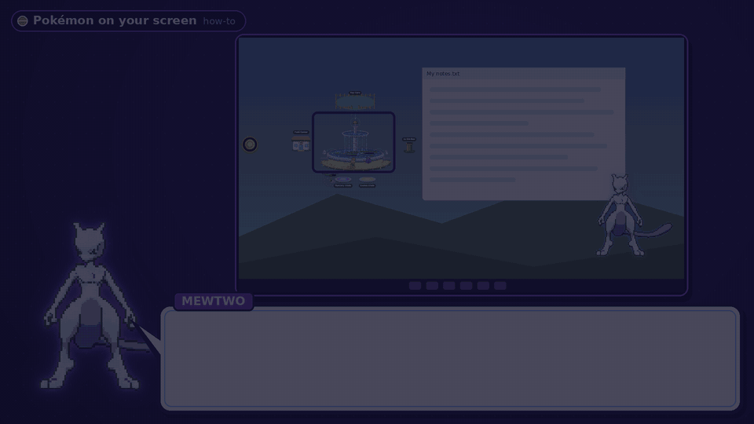 | **Weaken and catch** 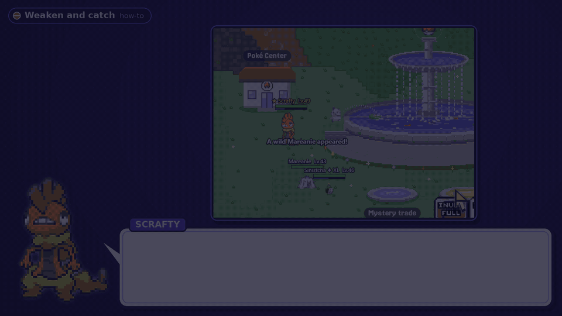 |
| **The Field Dex** 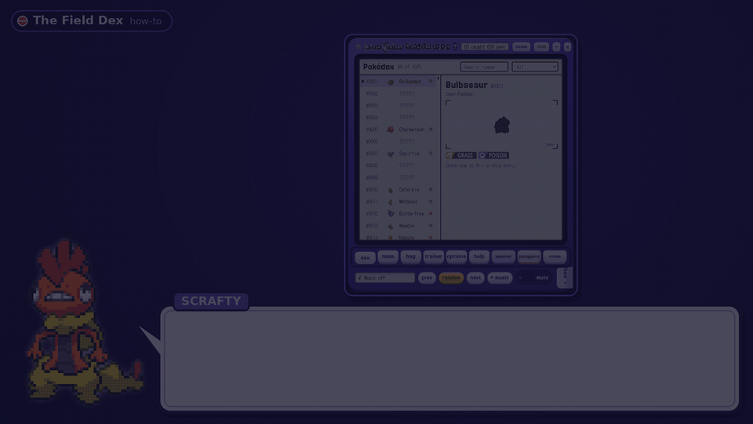 | **Transparency and startup** 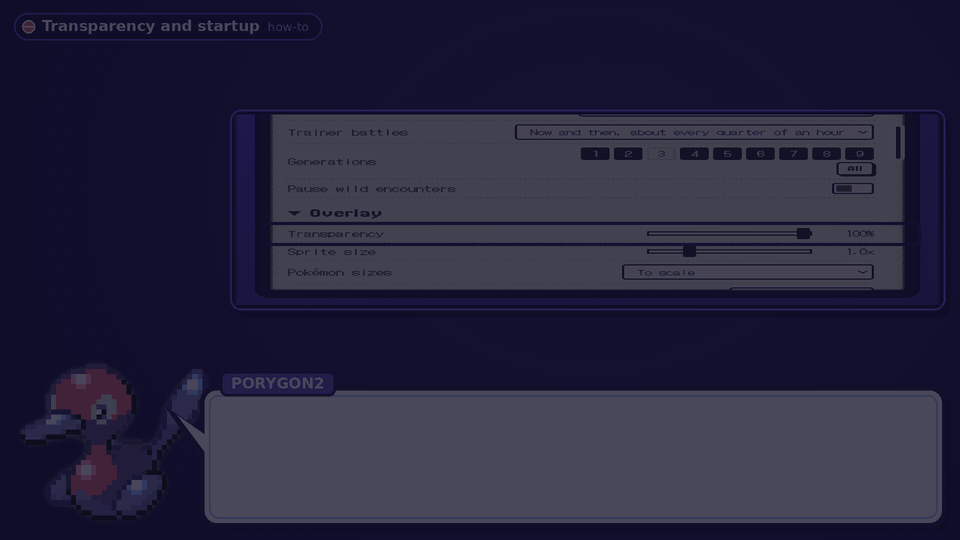 |
| **The Field window** 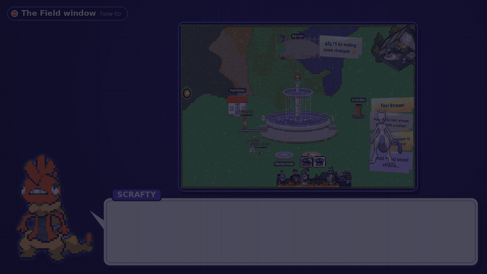 | **Mewtwo, computer guardian** 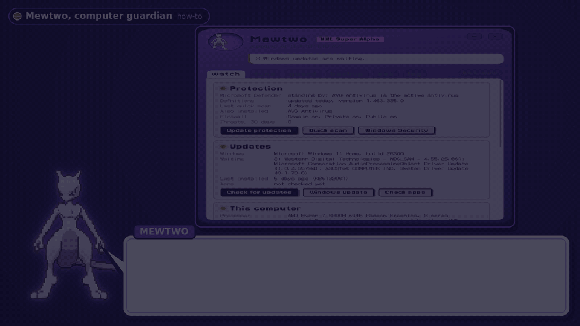 |
| **Rotom's big tidy-up** 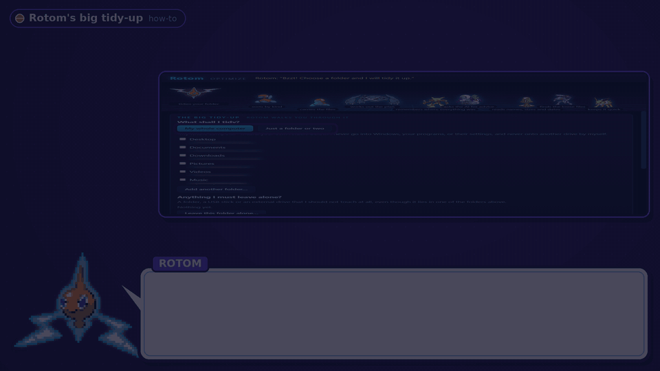 | **MyStream studio** 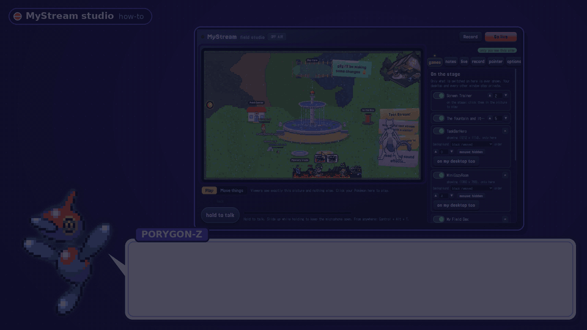 |
| **Visit other Trainers** 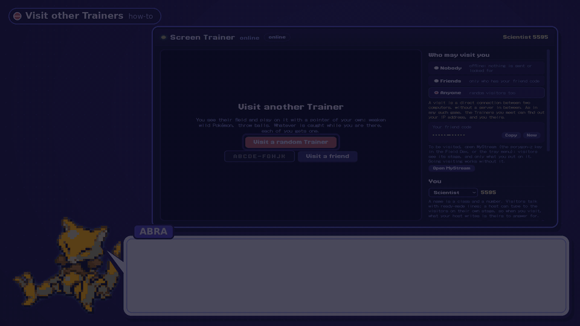 | **The Unown Notepad** 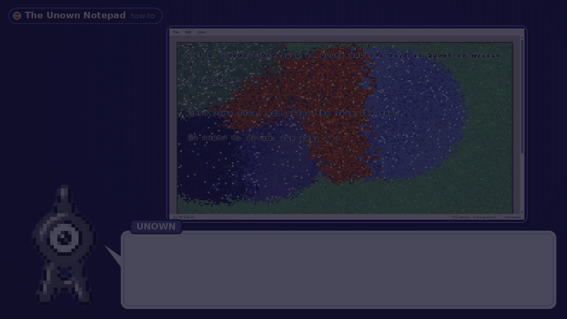 |
| **Mods and forks** 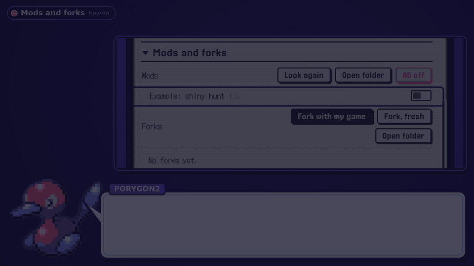 | **Saving, loading and the Escape Rope** 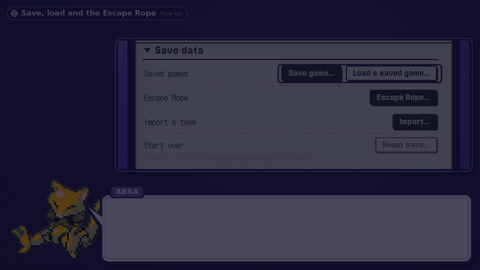 |

## Download and run (no installer)

Screen Trainer runs from its folder. Nothing is installed; to remove it, delete the folder (your save lives in
`%APPDATA%\Screen Trainer` on Windows, `~/.config/Screen Trainer` on Linux, `~/Library/Application Support/Screen Trainer` on a Mac).

| Download | Status |
|---|---|
| [`ScreenTrainer-1.0.0-windows-x64.zip`](https://github.com/Studioaecks/screen-trainer/releases/latest/download/ScreenTrainer-1.0.0-windows-x64.zip) | The main build. Tested on Windows 11. |
| [`ScreenTrainer-1.0.0-linux-x64.zip`](https://github.com/Studioaecks/screen-trainer/releases/latest/download/ScreenTrainer-1.0.0-linux-x64.zip) | Untested. The overlay needs a desktop with a compositor. Mewtwo, Rotom's big tidy-up and MyStream's game windows are Windows-only. |
| [`ScreenTrainer-1.0.0-mac-arm64.zip`](https://github.com/Studioaecks/screen-trainer/releases/latest/download/ScreenTrainer-1.0.0-mac-arm64.zip) (Apple chip), [`-mac-x64.zip`](https://github.com/Studioaecks/screen-trainer/releases/latest/download/ScreenTrainer-1.0.0-mac-x64.zip) (Intel) | Untested and not signed. Mewtwo, Rotom's big tidy-up and MyStream's game windows are Windows-only. |
| [`ScreenTrainer-1.0.0-source.zip`](https://github.com/Studioaecks/screen-trainer/releases/latest/download/ScreenTrainer-1.0.0-source.zip) | Everything in this repository. |

1. Unzip it anywhere (right-click > Extract All on Windows). Do not run it from inside the zip.
2. Start `Screen Trainer\ScreenTrainer.exe` (Windows), `Screen Trainer/start.sh` (Linux) or `Screen Trainer.app` (Mac).
3. Tray icon > Pokédex > options > Overlay > **Sprites folder**: choose a sprites folder of your own (one holding the
   folders `pokemon` and `items`, as the "sprites-master" collection does).
4. Optional: options > Sound > **Import from ROM** reads the sounds from a FireRed, LeafGreen, Ruby, Sapphire or
   Emerald ROM that you own, once.

Windows SmartScreen or an antivirus may warn the first time, because the program is not signed by a company. See
`READ ME FIRST.txt` in the zip for how to allow it.

## What is new in 1.0

- **Escape Rope** (tray > Saved games, or options > Save data): packs your whole Screen Trainer folder, with your
  sprites, sounds, saved game and options, into one zip to take to another computer.
- **Mods**: a folder in `mods` with a `mod.json` changes starting options, how often Pokémon come, or the Field Dex
  colours. Every mod is checked and off until you switch it on. See `mods/README.txt` and the example mod.
- **Forks**: a full copy of the program with its own save, to change and try beside the real game without danger.
- **Sound sliders**: one for all of Screen Trainer, one for the cries, and in MyStream one per game (the game's own
  slider in the Windows volume mixer) plus the computer's sound and the microphone in the stream.
- The Field Dex no longer shows "caught / seen" at the top (the Trainer screen has it).
- Saving and loading a game is also in the tray menu.

## Working on it

Plain JavaScript on Electron 45, no build step and no npm packages at run time. Edit a file, restart, see it.
Start with `AGENTS.md` (the rules that must stay true, where everything is, how to check a change). The checks run
with plain Node: `node tools/playtest.js`, `node tools/guardiancheck.js`, `node tools/v07check.js`, `node tools/v100check.js`.
To run from the source: `npx electron@45.3.0 .` in this folder. `BUILDING.md` says how the release zips are made.

## License

Screen Trainer's code is under the [MIT License](LICENSE): use it, change it, share it. The license does not cover
Pokémon names, pictures or sounds, including where they appear in the how-to videos.

## Not made by Nintendo

Screen Trainer is a fan project. It is not made, endorsed or supported by Nintendo, Game Freak, Creatures or The
Pokémon Company, who own Pokémon and everything about it. The program contains none of their pictures or sounds; the how-to videos show it running with them, for friends and family.
